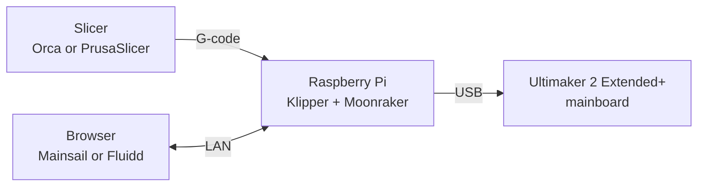

# KlipperMaker

**Running an Ultimaker 2 Extended+ on Klipper — from flashing the Raspberry Pi to a tuned first layer.**

**Status:** v0.1.0 — every number in this guide was measured on the machine described below.

Most Klipper guides assume an Ender 3. Most Ultimaker 2 guides assume the stock firmware.
This one covers the gap in between: a real UM2 Extended+ converted to Klipper, with every number
measured on the machine instead of copied from someone else's profile.

It is written for someone who has never used Klipper. You should be comfortable flashing an SD card
and typing commands in a terminal. Nothing else is assumed.

---

## Before you start

| You need | Notes |
|---|---|
| Ultimaker 2 Extended+ | The guide is specific to this printer's motors, heaters and 2.85 mm filament path |
| Raspberry Pi 3, 4, 5 or Zero 2 W | Older boards (Pi 1/2, Zero 1) are too slow and cause print stalls |
| microSD card, 8 GB or larger | For the Pi's operating system |
| USB cable | Pi to the printer's mainboard |
| Calipers | You will measure extrusion and wall thickness; without them the tuning is guesswork |

You do **not** need to change the printer's mechanics. Two things do need attention: the mainboard must be flashed with Klipper firmware ([chapter 8](docs/08-flash-firmware.md)), and this config assumes a part-cooling fan in addition to the stock heatsink fan (see the fan warning in `config/printer.cfg`).

## The path

| Step | What you do | Time |
|---|---|---|
| [1](docs/01-get-started.md) | Flash a Raspberry Pi, install Klipper, Moonraker and a web interface | ~1 hour |
| [1b](docs/08-flash-firmware.md) | **Flash Klipper onto the printer board** — without this the Pi and printer cannot talk | ~20 min |
| [2](docs/02-config.md) | Understand and verify the printer configuration | ~1 hour |
| [3](docs/03-tuning.md) | Tune the machine, in the right order | ~3 hours |
| [4](docs/04-slicers.md) | Set up Orca Slicer or PrusaSlicer with the measured values | ~30 min |
| [5](docs/05-agent.md) | Optional: let an AI agent help with the tuning | ~30 min |

Something broken? Start at [troubleshooting](docs/06-troubleshooting.md).
Every number behind every recommendation is in [results](docs/07-results.md).

## The numbers, in one table

Measured on this machine with 2.85 mm PLA, a 0.4 mm nozzle and a ~700 mm Bowden tube.
Your machine may differ — the guide shows how to measure your own.

| Setting | Value |
|---|---|
| Rotation distance (X/Y) | 40 |
| Rotation distance (Z) | 16 |
| Rotation distance (extruder) | 8.6227662 |
| Maximum acceleration | 7000 mm/s² |
| Maximum velocity | 300 mm/s |
| Pressure advance | 0.28 |
| Retraction | 5.0 mm at 45 mm/s |
| Nozzle / bed temperature | 220 °C / 60 °C |
| Flow | 1.0 |
| Layer height | 0.2 mm |
| Overhang limit | 45° design (55° measured) |

## The five things we wish we had known

1. **Corner bulges are usually acceleration, not pressure advance.** Below roughly 1500 mm/s² the
   print head lingers at each corner and plastic oozes into it. Raising acceleration fixed it.
2. **Slicers can silently cap your acceleration.** A `M204 P1500 T1500` line overrides the
   machine's 7000 mm/s². (A bare `M204 P1500` is ignored — Klipper needs `S`, or both `P` and `T`.)
   Check the G-code before you blame the printer.
3. **Arc support is switched off in this config.** Any `G2`/`G3` is answered with
   `Unknown command:"G2"` and skipped. Leave arcs off in the slicer, or add `[gcode_arcs]`
   on purpose.
4. **A long Bowden tube makes pressure advance weak.** Don't chase a perfect value; it barely
   changes the result here.
5. **Anything that waits leaves a blob.** If the printer pauses for a temperature change, retract and
   park away from the part first.

## Tested with

| Component | Version |
|---|---|
| Klipper | v0.13.0-642 (master) |
| Moonraker | v0.10.0-19 (master) |
| Mainsail | v2.17.0 (Fluidd also works) |
| PrusaSlicer | 2.8.1 |
| OrcaSlicer | 2.x |

## What this guide does not cover

- Hardware modifications (direct drive, new hotend, bed upgrades)
- Input shaping with an accelerometer — worth doing later, but not required to get printing
- Multi-material or a second extruder
- Printing anything other than PLA

## Repository map

Every file, and what it is for.

| Path | What it is |
|---|---|
| `README.md` | This page: what the project is, what you need, and the order to do things in |
| `docs/01-get-started.md` | Flash the Pi, install Klipper / Moonraker / Mainsail, find the printer's USB name |
| `docs/08-flash-firmware.md` | Put Klipper on the printer's own board: build, flash over USB, recover if it fails |
| `docs/02-config.md` | Every block of `printer.cfg` explained, and how to check it before homing |
| `docs/03-tuning.md` | The tuning ladder: retraction, flow, temperature, acceleration, pressure advance |
| `docs/04-slicers.md` | Set up Orca Slicer or PrusaSlicer, and check the G-code before you print |
| `docs/05-agent.md` | Optional: let the Hermes AI agent run the tests and read the results |
| `docs/06-troubleshooting.md` | Symptom, cause and fix, built from real failures on this machine |
| `docs/07-results.md` | The evidence: every test we ran, what it measured, how sure we are |
| `docs/images/` | Photos used by the guide |
| `config/printer.cfg` | A working Klipper configuration for this printer, with comments |
| `config/macros.cfg` | `PRINT_START` and `PRINT_END`: the safe way to begin and end a print |
| `presets/prusaslicer-um2.ini` | A PrusaSlicer profile you can load as it is |
| `presets/orca-notes.md` | The same settings as a field-by-field Orca checklist |
| `tools/make_test_gcode.py` | Generates the calibration prints: PA, flow, acceleration, temperature, retraction |
| `tools/scrub_check.py` | Scans the repo for personal data before you publish your fork |
| `CONTRIBUTING.md` | How to send a correction, and the writing style |
| `CHANGELOG.md` | What changed in each version, and what is still missing |
| `LICENSE` | MIT: use it, change it, share it |

## Contributing

Corrections and additions are welcome. Keep the writing plain: short sentences, no jargon without
an explanation, and real measured numbers rather than "it depends". See
[CONTRIBUTING.md](CONTRIBUTING.md).

If you run this guide on your own machine, please [open a machine report](../../issues/new?template=printer-report.yml)
with your measured values. Different printers are how this stays honest.

## License and credits

Released under the MIT license — see [LICENSE](LICENSE).

The overhang test model recommended in the tuning guide is
[Overhang Test by tomi3d](https://www.printables.com/model/126029-overhang-test), licensed
CC BY-NC 4.0. It is not included in this repository.

Klipper is by Kevin O'Connor and contributors. Moonraker, Mainsail and Fluidd are their own
projects. This guide just connects them.
